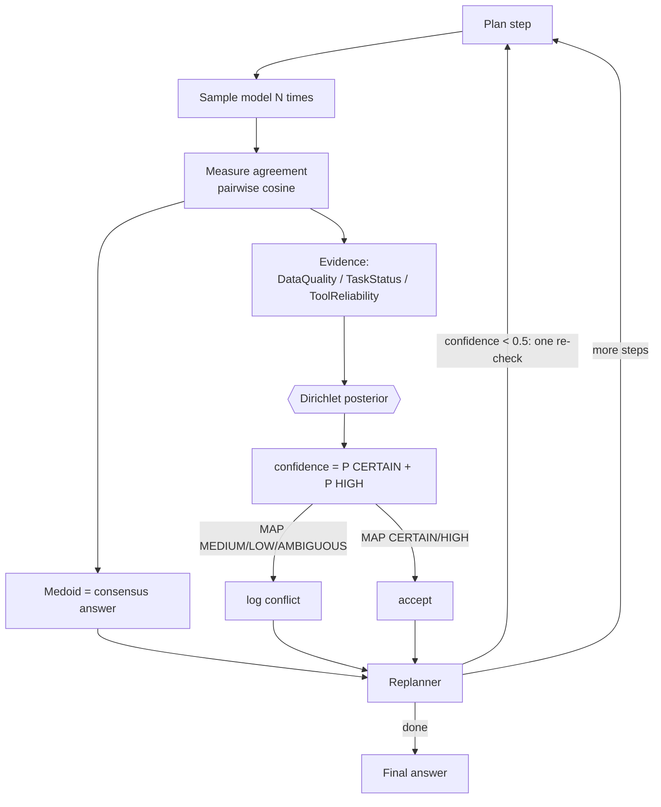

# Execution Model: Self-Consistency as a Confidence Signal

Implementation: `nodes/llm_executor.py` + `nodes/executor.py`.

A naive agent runs a step once and trusts it, leaving the Bayesian resolver nothing real to
act on. Instead, the executor runs each step **N times at temperature > 0** and measures how
much the samples agree. Sample disagreement is a well-supported proxy for model uncertainty
(self-consistency, Wang et al. 2022).

## The three signals (real measurements, not keywords)

| Signal | Measured from | Maps to |
|---|---|---|
| `DataQuality` | mean pairwise agreement of samples | low agreement ⇒ degraded |
| `TaskStatus` | fraction of non-refusal/non-empty samples | refusals ⇒ degraded |
| `ToolReliability` | distinct answers / N (rewordings grouped) | high dispersion ⇒ unstable |

Each maps onto `0 = CERTAIN … 4 = AMBIGUOUS`, e.g. `DataQuality = clip(round((1−agreement)×4))`.
Agreement is cosine similarity, measured one of two ways:

- **Word overlap** (default): bag-of-words cosine. No extra service, but it reads meaning
  poorly — "died in 1912" vs "his death occurred in the year 1912" scores 0.38.
- **Embeddings** (`EMBEDDINGS_BASE_URL` set): cosine of sentence embeddings from a second
  llama-server, e.g. `llama-server -hf second-state/All-MiniLM-L6-v2-Embedding-GGUF:Q8_0
  --embeddings --port 8081`. The same 1912 pair scores 0.95, and "Paris is the capital of
  France" vs "Berlin is the capital of Germany" drops from 0.67 to 0.35.

Neither catches contradictions or changed numbers: "the capital is Sydney" vs "…Canberra"
scores 0.88 on embeddings and 0.83 on words. That is NLI's job, and is why the number check
below exists.
The **medoid** — the sample most similar to all others — is the consensus answer returned.

"Distinct answers" groups rewordings: two samples are one answer when their similarity
clears a cut-off (0.8 for words, 0.9 for embeddings, since a contradiction scored 0.88)
**and** they state the same numbers. Counting exact strings instead made every long sample
distinct at temperature 0.7, so `ToolReliability` sat at 4 on every live step and carried no
information. The number check matters because word overlap alone calls "3 users" and
"12 users" the same answer.

The step prompt also tells the model it has no data access and must never invent names,
IDs, numbers or records; "I don't have access…" counts as a refusal for `TaskStatus`.

## Confidence

The three signals feed `resolve_conflict`, which returns a posterior over outcome quality
plus a credible interval. The step's scalar confidence is `P(CERTAIN) + P(HIGH)`. When the
MAP outcome is MEDIUM/LOW/AMBIGUOUS the step is logged as `bayes.conflict_resolved`.

The replanner acts on it (`nodes/replanner.py`):

- Every completed step is shown to it with its confidence, and the prompt asks it to
  re-check or flag anything below 0.5.
- **Hard rule:** if the step just run scored below 0.5, the replanner queues
  `Re-check: <step>` without consulting the model. A re-check is never re-checked, and a
  step where every sample refused ("I don't have access…") is not re-checked at all —
  asking again can't produce data the model doesn't have.
- It stops after `MAX_STEPS` steps, and drops steps that are a completed step with its old
  result tacked on (`"step: result…"`) — a live 3B model looped on exactly that.

If the replanner never writes a clean final answer, the fallback joins the step results,
using each re-check's result instead of the attempt it replaced and listing identical
results once.

The run's reported `confidence_score` is its **weakest** step, counting each step's latest
attempt (a re-check replaces the attempt it re-checked); `step_confidences` lists them all.

This is the distinctive bit: the system **quantifies its own uncertainty from the model's
behaviour**, fuses three signals into one confidence, and the loop acts on it.

## Learning from feedback

`POST /jobs/{id}/feedback {"correct": true|false}` on a finished job runs the conjugate update
for every step's evidence (correct → `CERTAIN`, wrong → `AMBIGUOUS`, as in the eval), once
per job. Set `ENGINE_STATE_PATH` to persist the learned counts across restarts; without it
learning lasts only for the process. Counts are per process, so replicas each learn
separately until they share that file or a store.

## Config & fallback

| Env | Default | Meaning |
|---|---|---|
| `EXECUTOR_SAMPLES` | 4 | samples per step (1 disables self-consistency) |
| `EXECUTOR_TEMPERATURE` | 0.7 | sampling temperature |
| `EXECUTOR_EVIDENCE` | `self-consistency` | `keywords` opts into the legacy extractor |
| `EMBEDDINGS_BASE_URL` | unset | embedding server for meaning-based agreement; unset = word overlap |
| `EMBEDDINGS_MODEL` | `local-embeddings` | name recorded in eval provenance |
| `MAX_STEPS` | 10 | executed steps before the run stops and returns what it has |
| `ENGINE_STATE_PATH` | unset | file the engine's learned counts are saved to / loaded from |

**One evidence path.** With no model the executor swaps the backend, not the measurement:
`_MockToolSampler` is a deterministic *fake tool* whose scripted readings sometimes
disagree, and those samples go through the same agreement computation a live model's would.
So the offline suite exercises the real machinery and stays reproducible.

The repo used to derive offline evidence by keyword-matching the result text, which
contradicted the claim above — two notions of "evidence", only one of them measured. That
extractor now lives in `core/signals.py` as an explicit opt-in
(`EXECUTOR_EVIDENCE=keywords`) for deployments with no sampling budget, where a single-shot
tool returns text and there is no disagreement to measure. It is never the default, and
`tests/test_e2e.py::test_executor_evidence_defaults_to_self_consistency` fails if it ever
becomes one.

## Does any of this actually work?

Self-consistency is a *proxy* for correctness, not a proof of it, so the claim is tested
rather than asserted: `eval/` scores these confidences against gold answers with reliability
diagrams, ECE, AUROC and risk-coverage, against baselines including raw agreement with no
Bayesian layer at all. See [CALIBRATION.md](CALIBRATION.md).

## Limitations

Word-overlap agreement misses paraphrases (embeddings fix this); neither measure sees
contradictions; N samples cost N× tokens; and
self-consistency measures *internal* consistency, not factual truth, which is a confidence signal,
not an oracle.
